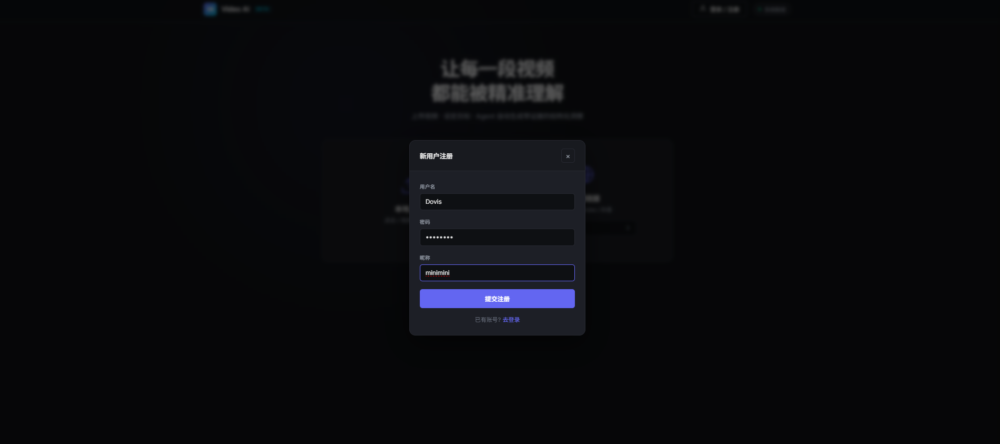
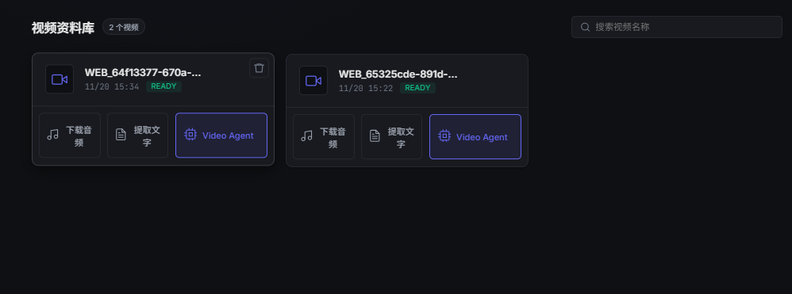
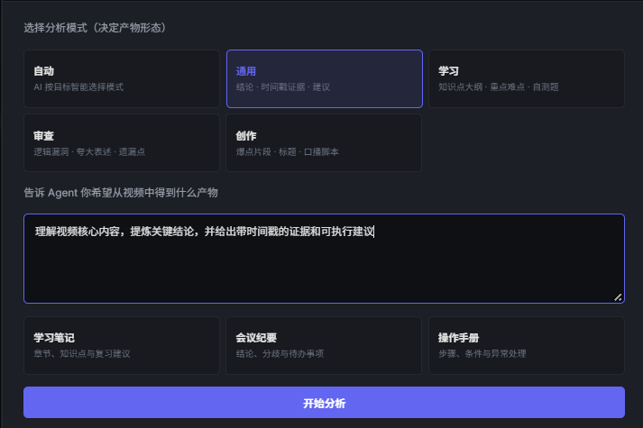
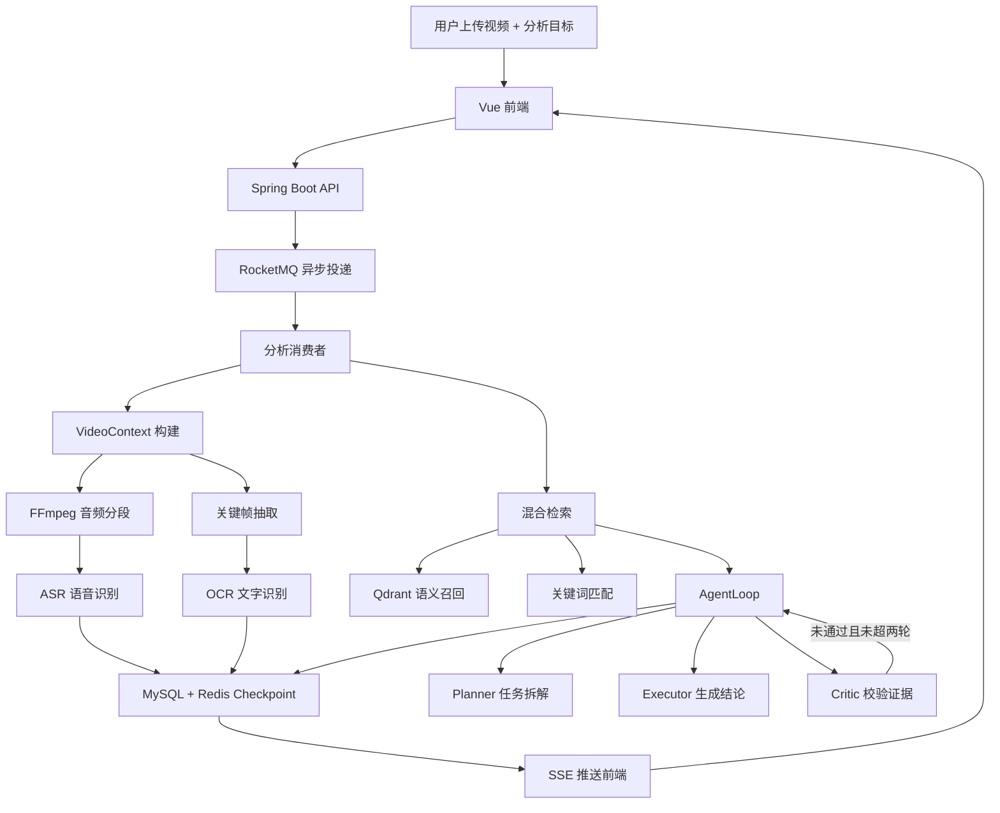

<div align="center">
  <h1>🎬 Video-AI</h1>
  <p align="center">
    
    
    
    
    
    
  </p>
  <p align="center">
    <strong>面向长视频内容理解的 Video Agent</strong><br/>
    将长视频转化为可检索、可追溯、可追问的结构化知识
  </p>
</div>

---

## ✨ 核心特性

| 特性 | 说明 |
|------|------|
| 🎬 **可靠任务链路** | 分片上传 + 断点续传 + 异步削峰，提交即返回 |
| 🧩 **多模态上下文** | ASR + OCR + 关键帧融合，统一时序结构 |
| 🔁 **证据约束 AgentLoop** | Planner → Executor → Critic，每条结论必绑时间戳证据 |
| 🔍 **长视频检索** | Embedding + 关键词混合召回，Qdrant 向量库 |
| 🛡️ **成本护栏** | 令牌桶限流 + 指数退避重试 + Agent 轮次上限 |
| 🔄 **断点恢复** | MySQL Checkpoint + Redis 热缓存，任务中断可续跑 |

## 🖼️ 项目预览

**登录注册**



**视频工作台**



**Agent 目标输入**



用户完成登录后，上传视频 → 选择视频 → 输入分析目标 → 手动或自动选择分析模式。工作台展示结构化结论、时间戳证据、执行计划、阶段轨迹与质量评估，并支持基于同一视频继续追问。

## 📐 系统架构



## 🧩 四类分析模式

| 模式 | 产物 |
|------|------|
| **通用** | 结构化结论 + 时间戳证据 + 建议 |
| **学习** | 大纲 + 自测题 + 易错点 |
| **审查** | 逻辑漏洞 + 存疑结论定位 |
| **创作** | 爆点提取 + 标题 + 口播脚本 |

---

## 🛠️ 技术栈

| 层次 | 技术 |
|------|------|
| 前端 | Vue 3、Vite、SSE、Marked |
| 后端 | Java 21、Spring Boot 3.5、Undertow、MyBatis-Plus |
| 中间件 | RocketMQ、Redis + Redisson、MySQL、MinIO、Qdrant |
| 视频处理 | FFmpeg、Tesseract OCR、yt-dlp |
| AI | LangChain4j、DeepSeek、TeleSpeechASR、BGE-M3 |

---

## 🚀 快速开始

### 环境要求

| 组件 | 版本 | 用途 |
|------|------|------|
| JDK | 21 | 后端运行 |
| Node.js | 22 | 前端构建 |
| Docker | Compose v2 | 中间件编排 |
| FFmpeg | — | 音视频处理 |
| Tesseract | 含 `chi_sim` `eng` 语言包 | OCR |
| yt-dlp | 可选 | 解析在线视频链接 |

### 1. 准备配置

```bash
# Windows PowerShell
Copy-Item .env.example .env

# macOS / Linux
cp .env.example .env
```

编辑 `.env`，至少设置：

- 数据库密码（`DB_PASSWORD`）
- MinIO / Qdrant 密码
- **`SILICONFLOW_API_KEY`**（AI 接口必需）

> ⚠️ `.env` 已在 `.gitignore` 中，密钥只保存在本地，不要提交到仓库。

### 2. 启动中间件

```bash
# macOS / Linux
./scripts/dev-up.sh

# Windows：手动启动，或修改脚本后用 Git Bash / WSL 运行
docker compose up -d mysql redis minio qdrocketmq-namesrv rmqbroker
```

脚本会等待 MySQL、Redis、MinIO、Qdrant 和 RocketMQ 全部就绪。所有服务默认只监听 `127.0.0.1`，不会暴露到局域网。

### 3. 启动后端

```bash
# macOS / Linux
set -a && source .env && set +a
cd server && ./mvnw spring-boot:run

# Windows PowerShell
$env:DB_URL = "jdbc:mysql://localhost:3306/media_db?useSSL=false&serverTimezone=Asia/Shanghai&characterEncoding=utf-8&allowPublicKeyRetrieval=true"
# （复制 .env 里的其他变量到当前会话）
cd server && .\mvnw.cmd spring-boot:run
```

后端启动后访问 `http://localhost:9090/health`，应返回 `{"code":0,"message":"success","data":"UP"}`。

> 💡 推荐在 IDE 中安装 `.env files` / `EnvFile` 插件，Run Configuration 里直接关联 `.env`，免去手动 set 环境变量。

### 4. 启动前端

```bash
# macOS / Linux
set -a && source .env && set +a
cd client && npm ci && npm run dev

# Windows PowerShell
cd client && npm ci && npm run dev
```

打开 `http://localhost:5173` 即可使用。

> 🔬 只想看前端 UI：`http://localhost:5173/?demo` 进入 Demo 模式，使用内置示例数据，不依赖后端。

---

## ❓ 常见问题

| 现象 | 处理 |
|------|------|
| 后端连不上 MySQL / Redis | `docker compose ps` 确认服务健康，检查 `.env` 密码是否一致 |
| 前端无法连接后端 | 先访问 `/health` 确认后端存活，再检查 `VITE_DEV_PROXY_TARGET` |
| 视频解析提示命令不存在 | 确认 `ffmpeg` / `tesseract` 在终端可用，必要时设置 `FFMPEG_DIR` / `OCR_COMMAND` |
| AI 接口 401 或模型不可用 | 检查 `SILICONFLOW_API_KEY` 和模型名称，修改后重启后端 |
| Maven 提示 `maven-default-http-blocker` | `cd server && ./mvnw -s .mvn/central-settings.xml spring-boot:run` |

### 停止 & 清理

```bash
# 停止但保留数据
docker compose down

# 完全重置（⚠️ 会删除所有视频数据）
docker compose down --volumes
```

---

## 📁 项目结构

```
Video-AI/
├── client/              # Vue 3 前端工作台
├── server/              # Spring Boot 后端 + Video Agent
├── docker-compose.yml   # 中间件编排
├── scripts/             # 开发辅助脚本
└── .env.example         # 配置模板（不含真实密钥）
```

## 📄 License

[MIT License](LICENSE)